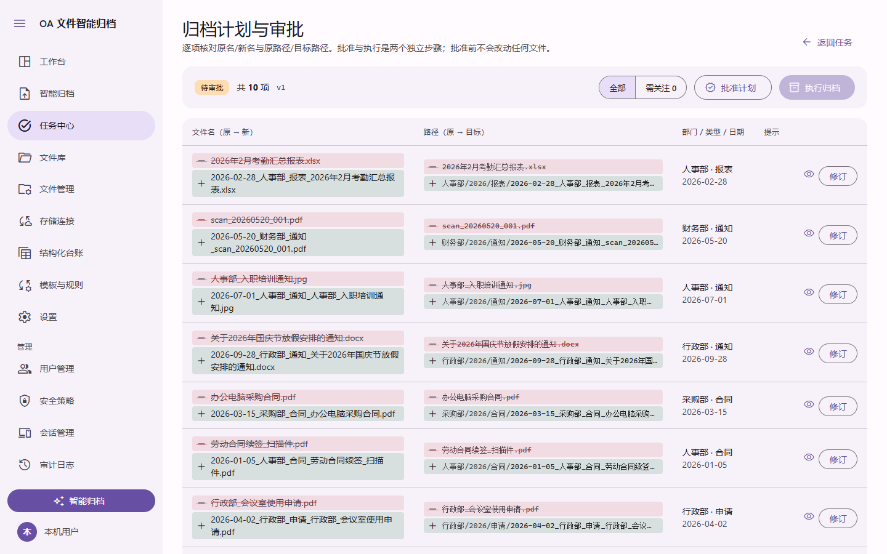

<div align="center">

# 企业 OA 文件智能归档智能体

**把一堆杂乱的 Word、Excel、PDF 和扫描件，变成命名规范、分类清晰、可检索的归档库。**<br>
AI 给出建议，你先预览、再审批、最后才执行；原件永远不被改动。

[](https://github.com/Koch2333/OA-Files-Agent/actions/workflows/check.yml)
[](https://github.com/Koch2333/OA-Files-Agent/releases)
[](LICENSE)


[下载](#下载) · [快速开始](#快速开始) · [功能](#功能) · [文档](docs/用户手册.md) · [参与开发](#参与开发) · [English](README.en.md)

</div>

<p align="center">
  
  <br><sub>归档计划：逐项核对原名与新名、原路径与目标路径，批准之前不会改动任何文件（截图为演示数据）</sub>
</p>

## 它做什么

1. **导入**：拖入文件或整个文件夹，数量和单个文件大小都不限制；大文件分块上传，断线可续传。
2. **识别**：文件名和正文（含 OCR）联合判断部门、类型和日期；证据不足的字段留空并要求人工确认。
3. **预览与审批**：生成"原名 → 新名、原路径 → 目标路径"的计划，你可以逐项修订，批准和执行是两个独立步骤。
4. **执行与回滚**：原件只复制不移动、不覆盖，重名自动加序号；整个过程有日志，可恢复，可一键回滚。
5. **台账**：自动生成可搜索的台账，可导出 Excel。

## 下载

在 [Releases](https://github.com/Koch2333/OA-Files-Agent/releases) 页下载，每个版本附统一的 `SHA256SUMS`。

| 平台 | 文件 | 说明 |
|---|---|---|
| Windows 10/11 x64 | `oa-agent-<版本>-windows-x64-setup.exe` / `-portable.zip` | 个人版，单机免登录，无需安装 Python、数据库或 Office |
| Windows 11 ARM64 | `oa-agent-<版本>-windows-arm64-setup.exe` / `-portable.zip` | **实验性**：文档 Worker 与内置 PostgreSQL 为 x64 仿真运行 |
| Linux amd64 / arm64 | `install.sh` 或 `oa-agent-<版本>-linux-<架构>.tar.gz` | 企业版，Docker Compose，多用户、MFA、审计 |

> Windows 安装包**未签名**，SmartScreen 会提示警告。校验：`sha256sum -c --ignore-missing SHA256SUMS` 或 `Get-FileHash`。

## 快速开始

### Windows（个人版）

安装 `setup.exe`（或解压便携 zip），双击 **OA 文件智能归档**。第一次使用在"设置"里配置识别引擎（见[下面](#llm-密钥配置)）。详见[用户手册](docs/用户手册.md)。

### Linux 服务器（企业版）

```bash
curl -fsSL https://github.com/Koch2333/OA-Files-Agent/releases/latest/download/install.sh | sudo bash
```

安装脚本会先**检测**主机上已有的 Docker、Compose、依赖工具、旧安装、端口占用者和数据库服务，只补装缺少的部分，然后用向导一问一答完成配置，最后给出确认页。

```bash
sudo bash install.sh --check          # 只读预检，不安装任何东西
sudo bash install.sh --status         # 查看已有安装的状态
sudo bash install.sh --config oa.conf # 用配置文件预设答案（权限必须是 600）
sudo bash install.sh --offline oa-agent-images.tar   # 无外网安装
oa-agentctl upgrade --tag <标签>      # 升级或回滚
```

支持自带 PostgreSQL，也可接入已有的 PostgreSQL、MySQL 8.0+、SQL Server 2019+，安装前会先校验权限和隔离。完整流程、退出码和排错见[Linux 部署指南](docs/部署指南-Linux.md)。

> 脚本的 Docker 和 Compose 逻辑已在真实 Docker 上跑通；用包管理器自动安装 Docker、systemd 自启、ARM64 和真实镜像仓库尚未在真机验证。

## 功能

| | |
|---|---|
| **识别引擎可配置** | DeepSeek、通义千问等预设，Base URL 和模型名可改；可拉取模型列表、测试连接；密钥 AES-GCM 加密保存 |
| **OCR 抢救** | 扫描质量差时自动增强、旋转、纠偏后重试，仍不可靠就强制转人工，不会瞎猜 |
| **出错可重试** | 模型服务出错时自动退避重试 3 次，之后给出明确原因和"重试"按钮，只重跑失败的文件 |
| **文件管理** | 浏览、预览、下载归档目录；重命名和移动同步台账；删除进入可恢复的回收站 |
| **存储连接** | S3 兼容、Azure Blob、WebDAV、SFTP、FTP、SMB、钉钉钉盘；可作为导入来源，或归档副本的只增备份目的地 |
| **多数据库** | PostgreSQL（默认）、MySQL 8.0+、SQL Server 2019+；专用库、最小权限、管理员批准后才建表 |
| **账号与安全** | 多用户和角色、Passkey、TOTP、恢复码、会话管理、审计日志（企业版） |
| **Material 3 界面** | 标准 Material 3 组件与 Material Symbols 图标，支持深色模式 |

### LLM 密钥配置

设置页有"简单模式"，几步完成。各平台的差别如下：

- **OpenRouter**：点"使用 OpenRouter 账号登录授权"（OAuth + PKCE），自动生成专用密钥并测试连接。
- **DeepSeek、通义千问、OpenAI 等**：这些平台没有面向第三方应用的"登录即得密钥"流程，所以做不到全自动。桌面版会弹出专用窗口，左边是平台的密钥页面，右边是分步指引；你复制密钥后点"使用这个密钥"即可。应用不会读取平台页面内容，也不会接触你的平台密码。
- 也可以直接粘贴密钥，或使用本地模型。

调研依据和限制见 [LLM 账号登录配置](docs/LLM账号登录配置.md)。

## 工作原理

```
 浏览器 / Electron ──▶ Go API ──▶ Agent Harness（LLM，只能调用只读工具）
        Vue 3            │  │
                         │  └──▶ Python Worker（解析、OCR、预览）
                         ▼
      PostgreSQL / MySQL / SQL Server（真相源，持久化任务队列）
                         ▼
          internal/archive（确定性代码：命名、冲突、原子写入、回滚）
```

- **模型只提建议，不执行。** 它只能通过带 Schema 的只读工具读取当前文件；文件内容当作数据，不当作指令。路径规范化、冲突处理和写入全部由 Go 的确定性代码完成，模型没有 shell，也没有写权限。
- **数据库是真相源**，Excel 只是导出。任务队列持久化，重启后自动续跑。
- 本机服务会拒绝跨站写请求和非本机 Host 头，防止网页脚本操控本地归档。

## 项目结构

| 目录 | 内容 |
|---|---|
| `backend/` | Go API（Gin 路由）、Agent Harness、归档、流水线、存储、启动器与管理命令 |
| `workers/document-ai/` | Python 解析与 OCR Worker（python-docx、openpyxl、PyMuPDF、RapidOCR） |
| `frontend/` | Vue 3 + TypeScript + Vite 界面 |
| `desktop/` | Electron 桌面外壳（Windows 个人版） |
| `contracts/` | `openapi.yaml`（唯一契约源）、`events.md` |
| `migrations/` | 各数据库的迁移脚本 |
| `deploy/` | Windows 打包、Linux 安装脚本与 Docker Compose |
| `docs/` | 用户手册、部署与设计文档 |
| `tests/samples/` | 带标注的演示样本（含损坏和加密文件） |

## 参与开发

需要 Go 1.23+、Node 22+、Python 3.12、PostgreSQL 16。最省事的方式是一键开发环境：

```bash
scripts/dev.sh up --mock      # Windows：powershell -ExecutionPolicy Bypass -File scripts\dev.ps1 up
# 打开 http://localhost:5173
```

分别运行测试：

```bash
cd backend && go vet ./... && go test ./...           # 设置 OA_TEST_DATABASE_URL 才会跑数据库集成测试
cd workers/document-ai && python -m unittest -v
cd frontend && npm ci && npm run build && npm test
python scripts/check_contracts.py                     # 契约校验
```

端到端验收、多数据库测试矩阵、构建与发布流程见[开发文档](AGENTS.md)和[构建与发布](docs/构建与发布.md)。提交 PR 时请说明行为变化、验证结果和跳过的部分；UI 变更请附截图。

> 打包发布前请先看[第三方许可证](docs/THIRD-PARTY-LICENSES.md)：PyMuPDF 为 AGPL。

## 已知限制

- 跨数据库的数据迁移尚未实现，只能为新部署选择数据库。
- 除 OpenRouter 外，其他平台无法做到"登录自动生成密钥"，只提供窗口引导。
- Windows 安装包未签名；ARM64 版为实验性。
- 尚未用真实模型服务商的网站和账号做过端到端验证。

## 许可证

[AGPL-3.0](LICENSE)。第三方组件与改编来源（含 OpenList）见 [THIRD-PARTY-LICENSES](docs/THIRD-PARTY-LICENSES.md)。
